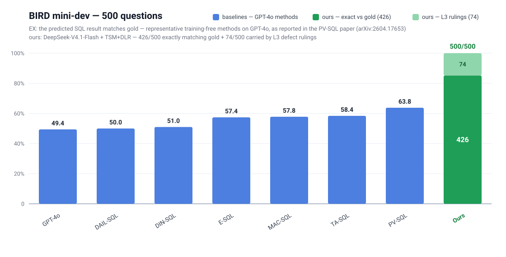
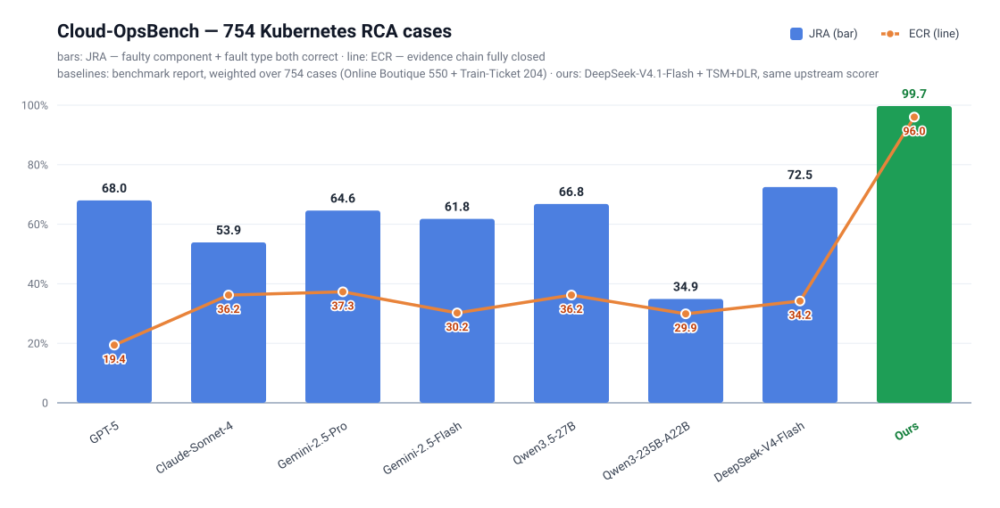

# DLR Proj —— Decoupled Logic Representation + 三级语义建模

[English](README.md) | 中文

[](#benchmarks) [-brightgreen)](#benchmarks) [](https://www.npmjs.com/package/dsh-tsm-agent)

**DLR（Decoupled Logic Representation）** 是本项目原创的**数据源级**语义建模范式：**LE / PE** 双层模型 + **ARCS**（投影锚定）与 **PAS**（语义路由）两个机制，把逻辑概念层与物理数据层解耦，让 LLM agent 可靠地把自然语言问题落到关系数据库上。详见 [docs/03-design.zh.md](docs/03-design.zh.md)。

项目跑在**三级语义建模（TSM）**框架下——**L1 `dlr`**（数据源级）/ **L2 `consensus`**（领域共识级）/ **L3 `sop`**（业务逻辑级）；一条知识进哪一级，**准入判据即治理线**。详见 [docs/02-concept.zh.md](docs/02-concept.zh.md)。

一份检出 = **五个 npm 包**（语义服务 · dsh bundle · 考试系统 · 两个开箱即用的场景包）+ 一层可插拔的场景机制：

| 部分 · npm 包 | 是什么 |
|---|---|
| `TSM Core Service/` · [`tsm-core-dlr`](https://www.npmjs.com/package/tsm-core-dlr) | 语义服务（TypeScript）：LanceDB 向量 + 图后端（内存图或 Neo4j）+ ONNX 编码器，经 streamable-http 暴露 **7 个 MCP 工具**（`dlr`；`dlr-state` 场景为 3 个） |
| `DSH-based Agent Service/dsh-tsm-agent/` · [`dsh-tsm-agent`](https://www.npmjs.com/package/dsh-tsm-agent) | **dsh bundle**：MCP 语义网关 + 场景无关的范式技能 + TSM 状态浮层 + agent 规则（启动器在 `DSH-based Agent Service/` 下） |
| `DSH-based Agent Service/dsh-tsm-eval/` · [`dsh-tsm-eval`](https://www.npmjs.com/package/dsh-tsm-eval) | **考试系统**：把场景的考卷经 dsh headless 跑一遍、`tsm grade` 采分、产出可回放报告（结果 + 过程 + 会话日志取证） |
| `scenarios/birdminidev/` · [`tsm-scenario-birdmini`](https://www.npmjs.com/package/tsm-scenario-birdmini) | 场景包 —— BIRD mini-dev（11 库 / 500 题）：三层源 + 考卷 + 跑批结果。**500/500 评定正确**（426 与 gold 完全一致 + 74 处按 L3 节口径裁定的数据集缺陷） |
| `scenarios/cloudopsbench/` · [`tsm-scenario-cloudopsbench`](https://www.npmjs.com/package/tsm-scenario-cloudopsbench) | 场景包 —— Cloud-OpsBench（K8s 根因诊断，754 例）：三层源 + 上游评分器适配 + 跑批结果。全量 754 例 **JRA 753/754（99.87%）** |
| *自带场景* | 场景层**可插拔** —— 把 `TSM_SCENARIO` 指向任意自带三层源（可选考卷）的场景包即可。换场景 checklist 见 [docs/04-application.zh.md](docs/04-application.zh.md) |

<a id="benchmarks"></a>
## 基准成绩

两个外部基准，都是端到端跑完的（每个案例都可在台账中查证）：

**BIRD mini-dev —— NL2SQL · 11 库 · 500 题** · 场景包 [`birdminidev`](scenarios/birdminidev/)



*BIRD mini-dev（500 题）执行准确率（EX）：GPT-4o 上代表性的免训练方法，取自 PV-SQL 论文（arXiv:2604.17653）。我方：DeepSeek-V4.1-Flash + TSM+DLR —— 426/500 与 gold 完全一致 + 74/500 按 L3 缺陷裁定。*

| 跑批 | 结果 | 备注 |
|---|---|---|
| 全部 500 题 | **500/500 评定正确** —— ✅ 426 与 gold 完全一致 + 🔁 74 处按 L3 节口径裁定正确（那些题 gold 本身有缺陷） | 零错误 · 每题 token 中位 ≈ 5.6 万 / 约 6 步 |

**Cloud-OpsBench —— Kubernetes 根因诊断 · 754 例**（Online Boutique + Train-Ticket）· 场景包 [`cloudopsbench`](scenarios/cloudopsbench/)



*Cloud-OpsBench（754 例）：JRA —— 故障组件 + 故障类型都对（柱）；ECR —— 证据链全闭（线）。基线：基准报告（arXiv:2603.00468），各模型分数按 Online Boutique（550）+ Train-Ticket（204）加权。我方：DeepSeek-V4.1-Flash + TSM+DLR —— JRA 753/754（99.87%）、证据链全闭 740/754（98.1%），由同一上游评分器判分。*

| 跑批 | 结果 | 备注 |
|---|---|---|
| 全量 754/754 例（100%） | **JRA 753/754（99.87%）** ✅ · 证据链全闭 740/754（98.1%） · 六项链全满 722/754（95.8%） | 流程分均值 MC 0.996 / EOC 0.980 · 无效动作 0.8% |
| 对照 —— 模型基线（基准自家评分器） | 基准报告最强基线：JRA 0.76（Online Boutique）/ 0.68（Train-Ticket），全 754 加权 ≈ 0.73；证据链闭合 0.38 / 0.15（探索面广、闭不上链） | 上游评分器原样判分，无人工翻盘 |

台账（逐题 + 证据）：[birdminidev](scenarios/birdminidev/DETAIL.md) · [cloudopsbench](scenarios/cloudopsbench/DETAIL.md)

## 目录

- [基准成绩](#benchmarks)
- [快速开始](#快速开始)
- [架构](#架构)
- [场景包](#场景包)
- [仓库结构](#仓库结构)
- [文档](#文档)
- [排障](#排障)
- [分支](#分支)

-----

<a id="快速开始"></a>
## 快速开始

### 前置

| 项 | 说明 |
|---|---|
| Node.js + npm | 服务是 TypeScript，经 `npx tsx` / `node` 运行 |
| Neo4j 5.x | 本机实例（免安装 zip + 便携 JDK）或任意 Bolt 端点——设 `NEO4J_HOME`（或 `NEO4J_URI`） |
| ONNX 编码器 | `bash "TSM Core Service/scripts/fetch-model.sh"`（~95 MB，走 hf-mirror） |
| 数据集 | BIRD mini-dev → 解压到 `MINIDEV_sqlite/`（gitignored）；下载源：[bird-bench/mini_dev](https://github.com/bird-bench/mini_dev) |
| dsh | `@deepseek-ai/dsh@0.2.0-rc.2`（alpha 预览；500 题跑批产出于 `0.1.7-alpha.1`、**未重跑**；升级后先 `--dump-config` 核行） |
| API key | `cp "DSH-based Agent Service/dsh_dlr/.env.example" "DSH-based Agent Service/dsh_dlr/.env"`，填 `DEEPSEEK_API_KEY` |
| 服务 env | `cd "TSM Core Service" && npm install && cp .env.example .env`（填 `NEO4J_PASSWORD`） |

### 1. 起语义后端

```bash
bash "DSH-based Agent Service/scripts/start_backend.sh"     # Neo4j + TS MCP server (:28795)；幂等
cd "TSM Core Service" && npx tsx src/verify/precheck.ts     # 预检——应列出 7 个工具
```

### 2. 单题（headless）

```bash
bash "DSH-based Agent Service/dsh_dlr/run_one.sh" 1471 \
  "What is the ratio of customers who pay in EUR against customers who pay in CZK?"
```

启动器会先预检后端，再跑 `dsh --profile headless --json`，事件流写入 `tmp_scripts/dsh_smoke/`（或你在第三个参数指定的目录）。

### 3. Web 对话

```bash
# 每个 profile 装一次 bundle，并在插件管理器里启用（或加进 profile 的 dsh.profile.bundles）
dsh plugin --profile web add "$(pwd)/DSH-based Agent Service/dsh-tsm-agent"
bash "DSH-based Agent Service/dsh_dlr/run_web.sh"
```

Harness 的**插件管理器**（设置 → 插件）一步完成装包 + 启用；上面的 CLI 只装包。MCP 端点可用环境变量 `TSM_MCP_URL` 覆盖。

右下角浮出 TSM 状态卡：图后端 / MCP 服务灯、LE/PE/PA 计数、向量行数、当前场景。

### 4. 批跑与判定

```bash
bash "DSH-based Agent Service/scripts/run_batch.sh" --qids 1471,1472 --jobs 4   # 或 --db <库名> | --all
cd "TSM Core Service"
node bin/tsm.mjs grade --run "<批次目录>"    # 判定 → questions.csv + summary.md
node bin/tsm.mjs stats                      # → results/STATS.md + 台账 DETAIL.md
```

### 重建语义资产（改源之后）

```bash
cd "TSM Core Service"
node bin/tsm.mjs build all                  # lance | consensus | sop | graph（graph 需 Neo4j 在跑；--wipe 重建）
```

改 L1 yaml / L2 consensus / L3 `sop.md` 后，必须重建对应索引再跑题。其他子命令：`tsm serve` · `status` · `coverage` · `viz` · `verify`。

-----

<a id="架构"></a>
## 架构

```
dsh（DeepSeek Harness：headless / web）
   │  MCP（streamable-http :28795，7 工具）
   ▼
TSM Core Service（TypeScript）：LanceDB（向量）+ ONNX 编码器（进程内）
   │  图后端（LE 50 / PE 74 / LA 277 / PA 784 · PAS 37 —— birdmini），双轨：
   │    · memory —— YAML → 进程内内存图（默认；零依赖）
   │    · neo4j  —— bolt :7687（可选；配了 NEO4J_URI 即启用；Browser :7474）
   ▼
数据集（MINIDEV_sqlite，gitignored；dlr-state 场景为基准快照）
```

**进程**：TS MCP server 常驻；Neo4j 只在用 Neo4j 图后端时启动（本仓库 `.env` 默认如此）。LanceDB 与编码器内嵌，不是服务。

<a id="场景包"></a>
## 场景包

**场景** = 一套完整 TSM：内容在 `scenarios/<名>/`，由服务消费。

| 层 | 载体 | 工具面 |
|---|---|---|
| L1 `dlr` | `sources/configs/DLR/*.yaml` → 图 + 向量 | `dlr_semantic_query` → `get_pe_mapping` / `get_le_attrs` |
| L2 `consensus` | `sources/consensus/*.jsonl` → 向量 | `dlr_search_consensus` |
| L3 `sop` | `sources/sop.md` → 检索索引（`tsm build` 编译） | `dlr_search_sop(question)` |

包内还有：`eval/questions.jsonl`（考卷——一行一题 `{question, expected, source}`；74 处缺陷裁定题的答案键取 L3 节口径，其余取 gold）、`results/<轮次>/`（跑批留档）、`fixtures/`（verify 套件对照真值）、`DETAIL.md` + `DETAIL/<库>.md`（台账）。

现有场景两个 —— **`birdminidev`**：BIRD mini-dev，11 库 / 500 题全部跑完并判定，**500/500**（✅ 426 + 🔁 74 数据集缺陷裁定；零错误）；每题 token 中位 ≈ 5.6 万（均值 7.3 万），约 6 步 / 10 次工具调用。**`cloudopsbench`**：Cloud-OpsBench —— 754 例 K8s 根因诊断，**JRA 753/754（99.87%）**。台账：[birdminidev](scenarios/birdminidev/DETAIL.md) · [cloudopsbench](scenarios/cloudopsbench/DETAIL.md)。

换场景：把服务指向另一个包（`TSM_SCENARIO=<路径>`）、重建，按 [docs/04-application.zh.md](docs/04-application.zh.md) 的 checklist 走。

-----

<a id="仓库结构"></a>
## 仓库结构

```
DLR Proj/                          # 分支 2.0
├── docs/                          # 叙事四篇（01–04）+ 操作三篇（run / eval / roadmap）+ README 索引
├── scenarios/birdminidev/         # ★ 场景包：sources/{configs,consensus,sop.md} + eval/ + fixtures/ + results/
├── TSM Core Service/              # 语义服务（TS）：LanceDB + Neo4j + MCP server
├── DSH-based Agent Service/       # dsh 接入：bundle（dsh-tsm-agent）/ 考试系统（dsh-tsm-eval）/ 启动器 / agent 规则
├── archive/                       # 历史（v2/v3 归档、旧文档与分享页）——只读
└── MINIDEV_sqlite/                # 数据集（gitignored，需下载）
```

<a id="文档"></a>
## 文档

| 我要… | 看这篇 |
|---|---|
| 懂"为什么" | [docs/01-background.zh.md](docs/01-background.zh.md) |
| 懂概念（三级 / 准入判据） | [docs/02-concept.zh.md](docs/02-concept.zh.md) |
| 建模（DLR 规范 + 自检清单） | [docs/03-design.zh.md](docs/03-design.zh.md) |
| 建/换场景包 | [docs/04-application.zh.md](docs/04-application.zh.md) |
| 跑（起后端 / 跑题 / web / 状态面 / 排障） | [docs/run.zh.md](docs/run.zh.md) |
| 评测（考卷 + 考试系统） | [docs/eval.zh.md](docs/eval.zh.md) |
| 可移植 / 扩展边界 | [docs/roadmap.zh.md](docs/roadmap.zh.md) |

<a id="排障"></a>
## 排障

| 症状 | 处置 |
|---|---|
| 单题跑满 timeout、无任何工具调用 | 后端没起：跑 `start_backend.sh`（启动器会预检并提前拦） |
| Web 报 `EADDRINUSE 3080` | 旧实例没死透：`netstat -ano \| grep :3080` → `taskkill //F //PID <pid>` |
| dsh 升级后模型报工具名不对 | 先 `--dump-config` 核 patch 行（bundle 已在 `0.2.0-rc.2` 上核过） |
| `tsm grade` 看着卡死 | 病态 agent SQL 有 20s 子进程硬超时护栏；慢 gold 查询走磁盘缓存（`TSM_GOLD_NO_CACHE=1` 可绕过） |
| 更多条目 | [docs/run.zh.md](docs/run.zh.md) 排障表 |

<a id="分支"></a>
## 分支

- **`2.0`**（本检出）——DLR + TSM 的持续线：场景包、TS 语义服务、dsh 接入。

> 仓库级执行约定（给 agent）：[CLAUDE.md](CLAUDE.md)。
