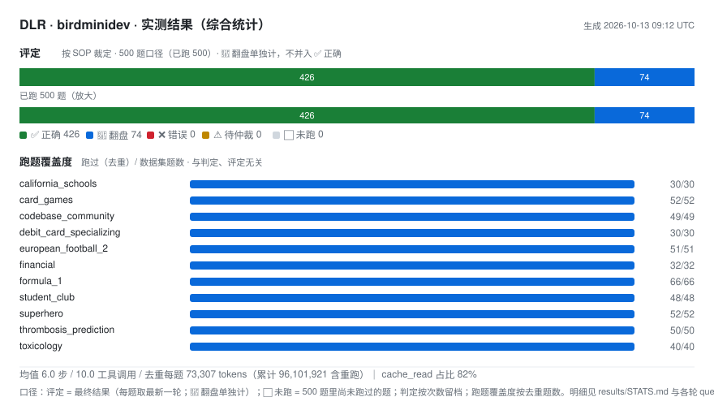

# Scenario 1 · NL2SQL (dataset `birdminidev`) — using TSM + DLR

English | [中文](README.zh.md)

> **Position**: the **first scenario** applying TSM (three-level semantic modeling) + DLR to a real NL2SQL dataset.
> **Spec and principles** (LE / PE / how tables abstract into two layers / modeling rules and self-check) live in **[docs/03-design.md](../../docs/03-design.md)**;
> this document runs in usage order: **dataset introduction (incl. dataset defects) → modeling approach → application results → workflow → measured results**.
> Scenario-package conventions (directory layout, scenario-switch checklist): [docs/04-application.md](../../docs/04-application.md).

## 1. Dataset introduction (including its defects)

### Native semantics: where the raw material lives

| Raw material | Location | Content |
|---|---|---|
| **Dataset version** | upstream [bird-bench/mini_dev](https://github.com/bird-bench/mini_dev) | **mini_dev 0703** — version-locked: runs and modeling follow this release, not upstream updates |
| **Column descriptions** | `MINIDEV_sqlite/dev_databases/<db>/database_description/*.csv` | `original_column_name, column_name, column_description, data_format, value_description` (BIRD native; **some columns carry no description**) |
| **Tables / columns / FKs** | `MINIDEV_sqlite/dev_tables.json` | table names, column names, foreign keys — **the FK list is incomplete** (debit_card registers only one) |
| **Physical truth** | the `<db>.sqlite` files themselves | `PRAGMA table_info / foreign_key_list` — **types and FKs follow the physical files** |
| **Questions and evidence** | `MINIDEV_sqlite/mini_dev_sqlite.json` | `{question_id, db_id, question, evidence, SQL, difficulty}`; **evidence is the author's hint** — most of L2/L3 derives from it |

### Dataset-defect record (problems exposed by runs ↔ SOP rulings)

> The dataset's own problems (gold defects / sample windows / distorted descriptions) are exposed by running questions, and each is carried by one L3 `sop.md` section ruling —
> **the dataset's mistakes are recorded here, and why we answer the way we do is here too** (the full story per question is in the sibling [DETAIL.md](DETAIL.md)).

<!-- mistakes:begin -->
| QID | DB | Ruling | Type | Question (excerpt) | Ruling rationale (full text in [DETAIL.md](DETAIL.md)) |
|---|---|---|---|---|---|
| q27 | california_schools | 🔁 overturned | hard question | What is the average score in writing for the schools tha | "Communication number" is the school's phone number -- there is no separate contact table. Date reading: "opened after 1991" means |
| q341 | card_games | 🔁 overturned | dataset issue | What are the borderless cards available without powerful | "Powerful foils" are the printings listed by the card marketplace **both** as a card and as a foil -- one of the two being present |
| q349 | card_games | 🔁 overturned | dataset issue | Name the card and artist with the most ruling informatio | "Ruling information" is the card's rulings: count the rulings attached to each card and take the largest -- **Teferi's Protection* |
| q352 | card_games | 🔁 overturned | dataset issue | Calculate the percentage of the cards availabe in Chines | "Percentage of the cards" puts **cards** on both sides of the fraction: the cards that have a Chinese Simplified printing, divided |
| q366 | card_games | 🔁 overturned | dataset issue | What is the rule of playing card "Benalish Knight"? | "The rule of playing card X" asks for the card's **rules text** -- the abilities printed on it. For Benalish Knight those are **fl |
| q371 | card_games | 🔁 overturned | dataset issue | What is the percentage of cards whose language is French | "Percentage of cards" puts **cards** on both sides of the fraction: the Story Spotlight cards that have a French printing, over al |
| q383 | card_games | 🔁 overturned | dataset issue · hard question | How many of the banned cards are white border? | "Banned cards" counts **cards**: a card banned in several formats is still one card, so count each card once -- 89 white-bordered |
| q402 | card_games | 🔁 overturned | dataset issue | What is the percentage of Story Spotlight cards that do | A card "does not have a text box" when it is **textless**. Check the Story Spotlight cards for that: **none of them is textless**, |
| q407 | card_games | 🔁 overturned | dataset issue · hard question | Lists all types of cards in German. | "Types of cards **in German**" asks for the type names as they read in German -- the German-language type strings recorded for Ger |
| q416 | card_games | 🔁 overturned | dataset issue · hard question | What percentage of cards without power are in French? | "Cards without power" = the cards whose power is missing or recorded as `*`. "In French" = the card has a French printing. The per |
| q483 | card_games | 🔁 overturned | dataset issue | Please list the Italian text ruling of all the cards in | "The Italian text of a card" is the card's **rules text as printed in Italian** -- one text per card (the text is a long block, so |
| q484 | card_games | 🔁 overturned | dataset issue | Please list the Italian names of the cards in the set Co | "Highest converted mana cost" in this set is 7, and **twelve cards share it** -- so the answer is twelve names, not one: Devastazi |
| q529 | card_games | 🔁 overturned | dataset issue | Find and list the names of sets which doesn't have Japan | A set "has a translation" in a language when that language's **text is actually present**: every set carries a row per language, a |
| q557 | codebase_community | 🔁 overturned | dataset issue | Among the posts with a score of over 5, what is the perc | "Among the posts with a score of over 5" is the denominator: **all** posts with a score above 5 (11,465 of them), each counted onc |
| q584 | codebase_community | 🔁 overturned | dataset issue | Write all the comments left by users who edited the post | "The comments left by users who edited the post" are the **notes the editing users left with their edits** -- the short note each |
| q639 | codebase_community | 🔁 overturned | dataset issue | Based on posts posted by Community, calculate the percen | The fraction puts **one set of posts** on both sides: the posts that use the R language, among the posts that account posted. That |
| q640 | codebase_community | 🔁 overturned | dataset issue | Calculate the difference in view count from post posted | "The posts posted by an author" are the posts that author owns, and a post's view count is the count the post itself records -- co |
| q672 | codebase_community | 🔁 overturned | dataset issue | Among the users located in United Kingdom, how many user | The question counts **users**, and "a favorite amount of 4 or more" is a post's own favorite count (not a sum across the user's po |
| q682 | codebase_community | 🔁 overturned | dataset issue | Which is the most valuable post in 2010? Please give its | "Most valuable" is the post carrying the largest **FavoriteCount**, and "in 2010" is the **post's own** creation year (the evidenc |
| q683 | codebase_community | 🔁 overturned | dataset issue | What is the percentage of posts whose owners had a reput | "In 2011" scopes the whole question -- the posts of that year, and among them the share whose owner's reputation is over 1000. Tha |
| q710 | codebase_community | 🔁 overturned | dataset issue | In posts with 1 comment, how many of the comments have 0 | "In posts with 1 comment" picks the posts whose **recorded comment count** is exactly 1 -- not the posts that merely happen to hav |
| q1473 | debit_card_specializing | 🔁 overturned | dataset issue | What was the average monthly consumption of customers in | Consumption is recorded customer-month by customer-month: every recorded figure is already one customer's consumption for one mont |
| q1481 | debit_card_specializing | 🔁 overturned | dataset issue · hard question | What is the difference in the annual average consumption | Per customer, total up their 2013 CZK consumption. Then, **per segment**, take the customer(s) with the lowest 2013 total. "Annual |
| q1482 | debit_card_specializing | 🔁 overturned | dataset issue | Which of the three segments—SME, LAM and KAM—has the big | The question names the currency, so the consumption must be filtered to customers whose billing currency is EUR (`Currency = 'EUR' |
| q1490 | debit_card_specializing | 🔁 overturned | dataset issue · hard question | How many percent of LAM customer consumed more than 46.7 | "Percent of customers" is counted **per customer**, not per customer-month record. One customer = one unit in both the numerator a |
| q1498 | debit_card_specializing | 🔁 overturned | dataset issue | What is the highest monthly consumption in the year 2012 | Consumption is recorded customer-month by customer-month, and each recorded figure is already one customer's monthly consumption. |
| q1500 | debit_card_specializing | 🔁 overturned | dataset issue | Please list the product description of the products cons | The individual-purchase records are only a **four-day sample**: they cover 2012-08-23 through 2012-08-26, and nothing else. Any mo |
| q1501 | debit_card_specializing | 🔁 overturned | dataset issue | Please list the countries of the gas stations with trans | Same sample-window fact: the individual-purchase records cover only 2012-08-23~26, so no purchases took place in June 2013, and th |
| q1505 | debit_card_specializing | 🔁 overturned | dataset issue | Among the customers who paid in euro, how many of them h | "Of them" means **customers**: count each Euro customer once, however many months cross the threshold. The condition is on a month |
| q1525 | debit_card_specializing | 🔁 overturned | dataset issue | What is the percentage of the customers who used EUR in | "Percentage of customers" = **customers**, not transactions: one customer counts once, in both the numerator and the denominator, |
| q1526 | debit_card_specializing | 🔁 overturned | dataset issue · hard question | For the customer who paid 634.8 in 2012/8/25, what was t | "paid 634.8" identifies the customer through a single purchase of that amount on that date -- a purchase-level condition, not a mo |
| q1529 | debit_card_specializing | 🔁 overturned | dataset issue | What is the amount spent by customer "38508" at the gas | "Amount spent by a customer" is that customer's total consumption across all gas stations -- a question about the customer's month |
| q1531 | debit_card_specializing | 🔁 overturned | dataset issue · hard question | Who is the top spending customer and how much is the ave | "Top spending customer" is decided by the customer's total consumption across all gas stations (the month-by-month figures), not b |
| q1028 | european_football_2 | 🔁 overturned | dataset issue | In Scotland Premier League, which away team won the most | "Away team won the most" = per away team, count how many matches it won away in that league and season, and take the largest count |
| q1029 | european_football_2 | 🔁 overturned | dataset issue | What are the speed in which attacks are put together of | "Speed in which attacks are put together" and "build-up play speed" are the same team attribute -- the question names one quantity |
| q1037 | european_football_2 | 🔁 overturned | dataset issue | Calculate the percentage of players who prefer left foot | "Percentage of players" counts **players**, not rating records: one player counts once in both the numerator and the denominator, |
| q1058 | european_football_2 | 🔁 overturned | dataset issue | Who has the highest average finishing rate between the h | The question compares exactly two players: the tallest and the shortest one. Compare their average finishing rates over their date |
| q1080 | european_football_2 | 🔁 overturned | dataset issue | Among the players whose preferred foot was the left foot | "Among the players ... how many of them" counts **players**: one player counts once, even though a player has many dated records ( |
| q1094 | european_football_2 | 🔁 overturned | dataset issue | How much higher in percentage is Ariel Borysiuk's overal | A player's rating is a **dated series of observations**, not one number: the same player has many rating records over the years. A |
| q1107 | european_football_2 | 🔁 overturned | dataset issue | When was the first time did Kevin Constant have his high | A player's scores are a dated series. "His highest crossing score" is the largest value in that series, and he can carry it on mor |
| q1115 | european_football_2 | 🔁 overturned | dataset issue | What percentage is Landon Donovan's overall rating highe | The question names a date, so take each player's rating record of that day, then express how much higher the first is as a percent |
| q1124 | european_football_2 | 🔁 overturned | hard question | Who are the players that tend to be attacking when their | "Tend to be attacking when their mates were doing attack moves" is the **high** attacking work rate; the answer is the list of pla |
| q1133 | european_football_2 | 🔁 overturned | dataset issue | How many football players born after the 1990s have the | "Born after the 1990s" here means born **after 1990** -- the players born from 1991 on whose name starts with Aaron. (Read literal |
| q1135 | european_football_2 | 🔁 overturned | dataset issue | Please provide top four football players' IDs who are am | Two readings decide this question, and both must be right: - **Right-footed**: only records whose preferred foot is the right one |
| q1136 | european_football_2 | 🔁 overturned | dataset issue | How many players had the highest potential score for cro | "The highest potential score for crossing" is the highest score in the **crossing** column (the best a player can reach at crossin |
| q1144 | european_football_2 | 🔁 overturned | dataset issue | Please state the finishing rate and curve score of the p | The heaviest player is the one with the largest weight; his attributes are a dated series, and with no date in the question take h |
| q1148 | european_football_2 | 🔁 overturned | dataset issue | What is the percentage of players that are under 180 cm | Two readings decide this question: - "An overall strength of more than 70" is the player's **overall rating** above 70 -- the over |
| q94 | financial | 🔁 overturned | dataset issue | List out the account numbers of female clients who are o | Two conditions pick one person and one district: the oldest female client (`gender = 'F'`, smallest `birth_date`) **within the dis |
| q95 | financial | 🔁 overturned | dataset issue | List out the account numbers of clients who are youngest | Both conditions apply to the same pick: the client with the largest `birth_date` (youngest) **inside the district whose average sa |
| q115 | financial | 🔁 overturned | dataset issue | For the branch which located in the south Bohemia with b | "The branch in south Bohemia with the biggest number of inhabitants" is the district with `A3 = 'south Bohemia'` whose `A4` (inhab |
| q129 | financial | 🔁 overturned | dataset issue | Which are the top ten withdrawals (non-credit card) by d | "Top ten withdrawals (non-credit card) by district" ranks the districts by the **total amount** of their non-card withdrawals (`ty |
| q152 | financial | 🔁 overturned | dataset issue | What is the average number of crimes committed in 1995 i | The candidates are the **distinct districts** with `A15 > 4000` that hold at least one account opened in 1997 or later -- **26 reg |
| q186 | financial | 🔁 overturned | dataset issue | What percentage of male clients request for weekly state | A client "requests weekly statements" when they hold an account whose frequency is `'POPLATEK TYDNE'` (link clients to accounts th |
| q847 | formula_1 | 🔁 overturned | dataset issue | What is the surname of the driver with the best lap time | The best lap in the second qualifying period is the smallest **non-empty** `q2` time of race 19: Kimi **Räikkönen**, `1:34.188`. T |
| q879 | formula_1 | 🔁 overturned | dataset issue | For the driver who set the fastest lap speed, what is hi | "Fastest lap speed" is the largest **numeric** `fastestLapSpeed`: **257.320** km/h, whose driver is **Brazilian**. The dataset's o |
| q906 | formula_1 | 🔁 overturned | dataset issue | Which was Lewis Hamilton first race? What was his points | The dataset holds **no 2007 Australian Grand Prix** (his real first race is absent from `races`), so his first race in the data is |
| q951 | formula_1 | 🔁 overturned | dataset issue | How many Japanese constructors have 0 points in 2 races? | **One** Japanese constructor carries zero points in exactly two standings rows: **Kojima**. The dataset's own query reports the ro |
| q962 | formula_1 | 🔁 overturned | dataset issue | From 2000 to 2005, what percentage of drivers who were b | Counted over **drivers**: every one of the 52 drivers of the 2000-2005 seasons was born before 1985, and all 52 have a race with m |
| q963 | formula_1 | 🔁 overturned | dataset issue | How many French drivers who obtain the laptime less than | Count **drivers**, not lap records: **9** French drivers hold a lap under two minutes (compare the time numerically, e.g. `millise |
| q1011 | formula_1 | 🔁 overturned | dataset issue | Which top 20 driver created the shortest lap time ever r | Rank the drivers by their **shortest lap** using the numeric `milliseconds` column and take the top twenty; the first eight are Le |
| q1322 | student_club | 🔁 overturned | dataset issue | Among the events attended by more than 10 members of the | A meeting is an event with `type = 'Meeting'`; "attended by more than 10 members" means more than ten attendance rows. **Four** me |
| q772 | superhero | 🔁 overturned | dataset issue | List the eyes, hair and skin colour of all female superh | List the **colour names**, one row per hero: **Buffy** (eyes Green, hair Blond, skin No Colour), **Elastigirl** (Brown, Brown, No |
| q1152 | thrombosis_prediction | 🔁 overturned | dataset issue | What is the ratio of outpatient to inpatient followed up | The question asks the ratio of **outpatient to inpatient** among SLE patients, so the outpatient count sits on top: 84 / 110 = **0 |
| q1205 | thrombosis_prediction | 🔁 overturned | dataset issue | Was the patient with the number 57266's uric acid within | Patient 57266 is male with UA readings 6.2 and 5.4 -- both **within** the normal male range (UA <= 8.0). The answer must carry the |
| q1241 | thrombosis_prediction | 🔁 overturned | dataset issue | For patients with abnormal platelet level, state the num | Abnormal platelet level is `PLT <= 100` or `PLT >= 400`. The number of **patients** below the range is **36** and above it is **82 |
| q1247 | thrombosis_prediction | 🔁 overturned | dataset issue | Among the male patients who have a normal level of white | Normal WBC is between 3.5 and 9.0; abnormal fibrinogen is `FG <= 150` or `FG >= 450`. Apply **all** the conditions together -- mal |
| q1251 | thrombosis_prediction | 🔁 overturned | dataset issue | How many patients with an Ig G higher than normal? | Higher than normal is `IGG >= 2000`, counted over patients of the laboratory table: **136**. The dataset's own query additionally |
| q1265 | thrombosis_prediction | 🔁 overturned | dataset issue | How many patients have a normal level of anti-ribonuclea | A normal anti-RNP reads `'negative'` or `'0'`, and the admission is `Admission = '+'`. Apply **both** conditions: **35** patients. |
| q197 | toxicology | 🔁 overturned | dataset issue | Calculate the average number of oxygen atoms in single-b | The average is taken over **all** single-bonded molecules -- including the ones with no oxygen atom (they count as zero): **2.1612 |
| q198 | toxicology | 🔁 overturned | dataset issue | On average how many carcinogenic molecules are single bo | The average is taken over **all** carcinogenic molecules (`label = '+'`), counting each molecule's single bonds (molecules without |
| q207 | toxicology | 🔁 overturned | dataset issue | What elements are in a double type bond? | The elements are the atoms that actually sit in a double bond (join `atom` to `bond` through `connected`, `bond_type = '='`): **c, |
| q218 | toxicology | 🔁 overturned | dataset issue | What percentage of carcinogenic-type molecules does not | Of the **152** carcinogenic molecules only **one** contains fluorine, so **151/152 = 99.34210526315789%** do not. The dataset's ow |
| q234 | toxicology | 🔁 overturned | dataset issue | How many bonds which involved atom 12 does molecule TR00 | Molecule TR009 has **3** bonds involving its atom `TR009_12` (via `connected`). The dataset's own query tests `'_1'` and `'_2'` (a |
| q263 | toxicology | 🔁 overturned | dataset issue | What is the composition of element chlorine in percentag | Among the single-bond molecules, count each molecule **once** and take chlorine atoms over all their atoms: **3.4823684499615513** |
<!-- mistakes:end -->

## 2. Modeling approach (raw material → three levels)

```
database_description/*.csv (column notes) ─┐
dev_tables.json (tables / columns / FKs) ──┼─▶ L1 `dlr` (every table & column covered; every description traceable)
SQLite PRAGMA (true types / FKs) ──────────┘        ↑ holds the correction right: L1 fills CSV blanks; flags drifted notes
evidence — the part about the source itself ┘ (value domains / granularity / sample windows / enums / encodings)
evidence — the rest ────────────────────────▶ L2 `consensus` (question conventions / term mappings / background; non-workflow)
modeling bugs · dataset bugs · recall clashes · hard-question breakdowns ─▶ L3 `sop` (question-level playbooks and traps)
```

**Reconciliation as self-proof**: `tsm coverage` (dev-time) turns those three steps into reconciliation sheets — L1 column/relation level (hard), L2 residual (heuristic).

**Modeling principles**: L1 writes one description per column, all taken from **the dataset's native material** (no semantic enrichment — fairness); the dataset's problems and pains are **not fixed in L1** — they are carried, and tagged, by the L3 `sop.md` (caliber: [docs/04-application.md](../../docs/04-application.md) §2).

## 3. Application results (this scenario's model)

| Database | LE | PE (table → LE) | PAS | Tables/cols | Abstraction decisions (highlights) |
|---|---|---|---|---|---|
| california_schools | 2 | School ← schools ｜ SchoolPerformance ← satscores+frpm | 1 | 3/89 | two scoring faces (sat / frpm) fold into one LE |
| card_games | 4 | Card ← cards ｜ CardExtension ← legalities+rulings+foreign_data ｜ CardSet ← sets ｜ SetTranslation ← set_translations | 3 | 6/115 | one card's many faces (legality / rulings / foreign printings) converge into one LE |
| codebase_community | 6 | User ← users ｜ Post ← posts ｜ PostInteraction ← comments+postHistory+postLinks ｜ Tag ← tags ｜ Badge ← badges ｜ Vote ← votes | 4 | 8/71 | three kinds of "post interaction" fold into one LE; Tag/Badge/Vote stay separate |
| debit_card_specializing | 4 | Customer ← customers ｜ Consumption ← yearmonth+transactions_1k ｜ GasStation ← gasstations ｜ Product ← products | 3 | 5/21 | monthly summaries and per-purchase samples — **two grains** under one Consumption LE, each spelled out by its own PE |
| european_football_2 | 5 | Player ← Player+Player_Attributes ｜ Team ← Team+Team_Attributes ｜ Match ← Match ｜ League ← League ｜ **Appearance ← Match (R=unwind)** | 4 | 7/199 | "main table + attribute faces" pair into one LE; **44 player-slot columns are exposed as a queryable relation via a row-level PE** (below) |
| financial | 6 | Account ← account+disp+card ｜ Client ← client ｜ District ← district ｜ Loan ← loan ｜ Transaction ← trans ｜ PermanentOrder ← order | 6 | 8/55 | the pure junction (disp) and cards **sink into PEs**; Loan/Transaction/Order — with lives of their own — rise to standalone LEs |
| formula_1 | 8 | Driver ← drivers ｜ Circuit ← circuits ｜ Race ← races ｜ DriverRaceData ← qualifying+results+lapTimes ｜ DriverStandings ← driverStandings ｜ PitStop ← pitStops ｜ Constructor ← constructors ｜ ConstructorRaceData ← constructorResults+constructorStandings | 4 | 13/94 | one race's many faces (qualifying / results / laps) fold into one LE |
| student_club | 8 | Member ← member ｜ Event ← event ｜ Attendance ← attendance ｜ Budget ← budget ｜ Expense ← expense ｜ Income ← income ｜ Major ← major ｜ ZipCode ← zip_code | 7 | 8/48 | the member↔event bridge (attendance) becomes its own LE; Major/ZipCode serve as dimensions |
| superhero | 3 | Superhero ← superhero+colour+race+gender+publisher+alignment ｜ Power ← hero_power+superpower ｜ Attribute ← hero_attribute+attribute | 2 | 10/31 | five fragmented dimension tables fold into the main LE (the "fragments concentrate" sample); Power/Attribute stand alone with PAS |
| thrombosis_prediction | 1 | Patient ← Patient+Laboratory+Examination | 0 | 3/64 | 3 tables share the `PatientID` anchor → **1 LE + 3 PEs + 0 PAS** (ARCS encodes the JOIN implicitly) |
| toxicology | 3 | Molecule ← molecule ｜ Atom ← atom ｜ Bond ← bond+connected | 3 | 4/11 | bond+connected merge into one LE; Atom/Molecule stand alone |
| **Total** | **50** | **74 PE** | **37** | 1,185 graph nodes (LE 50 + PE 74 + LA 277 + PA 784) + 37 PAS relations | |

### Row-level PE (`ARCS.R = unwind`): multi-slot FKs, first use case (football line-up slots)

**The problem**: the `Match` table carries **22 line-up slot columns** (`home_player_1..11` / `away_player_1..11`, each holding one `player_api_id`; plus `X`/`Y` variants whose semantics the dataset does not state). PAS is a **single-coordinate** router (one key per side) and cannot express "22 columns pointing at the same table"; under standard column-level modeling only, an agent computing "who started most often" would have to hand-write a 22-way `UNION ALL`.

**The design**: a PE is a **view, never materialized** — `ARCS.R` is by nature the **row-space definition** (not merely "row filters"). `R = unwind` expands one physical row into N derived rows over the slot columns:

```yaml
- logical_entity_id: LOGICAL.Appearance
  physical_entities:
  - physical_entity_id: PHYSICAL.Appearance
    physical_table_id: european_football_2.Match
    A: { cardinality: '1:N', key: MatchID }      # one match → 22 appearance rows (the detail face)
    R:
      kind: unwind
      pattern: '{side}_player_{slot}'
      side: [home, away]
      slot: ['1'..'11']
      value_as: player_id
      key: [id, side, slot]
```

**Implementation** (no physical change, no materialization): `get_pe_mapping(PHYSICAL.Appearance)` returns the derived columns (`MatchID / player_id / side / slot`) plus a **freshly generated `row_expansion`** — the R spec validated against the physical table (`missing=[]` means every column checks out) and expanded into a UNION-ALL SQL that can be pasted straight into `execute_sql`. Measured expansion: **542,281 rows / 25,221 matches**.

**Probe question and result** (experimental run; artifacts in `tmp_scripts/dsh_smoke/`, not in the ledger):

> **Q**: `In the 2015/2016 season, which player started the most matches in the home line-up? Give his name and the number of matches.`

| Item | Result |
|---|---|
| Ground truth (independent SQL recount) | **Virgil van Dijk, 20 matches** (tied with **Guillaume Gillet, 20**) |
| Agent behavior | `dlr_semantic_query` **recalls `LOGICAL.Appearance`** (the new LE enters the recall surface) → `get_pe_mapping(PHYSICAL.Appearance)` for the derived columns → aggregates directly on `side='home'` |
| Answer | **Correct, tie reported** (Gillet 20 = van Dijk 20), and it flagged the trap "group by `player_api_id`, not by name" on its own |
| Cost | **11 steps / 20 tool calls / 35k tokens** |
| Counterfactual | without this PE one must hand-write a 22-way UNION (the column names `home_player_1..11` are inferable from the PE's column descriptions, but stating "22 columns = one relation" is exactly the row-level view's job) |

**Boundary (explicitly out)**: the `X`/`Y` slot variants' semantics are not stated by the dataset → **not modeled** (no invented semantics in L1); `R = unwind` defines the row space only, and its derived columns are tagged `derived: true` (no physical column, `data_type = null`).

> ⚠️ Note: football's official run (51/51) was completed **before this PE landed**. **Deliberately not re-run**: none of the 51 questions' gold/evidence touches those slot columns, and this PE is **add-only** on the recall surface (a new standalone LE; no existing PE or description touched) → recorded as a post-config increment, not backfilled into the ledger.

## 4. Workflow (how this dataset is run)

```
① Modeling (one-off)   raw material → L1; evidence residual → L2                     tsm build
② Running (ongoing)    per question: dsh headless → answer → compare vs gold          run_one.sh / batch runner
②′ SOP kept live       every "dataset issue / modeling conflict / hard question / other" → a sop.md section, tagged
③ Re-runs              rerun the same batch to verify behavior after a section lands
④ Full sweep           **500 questions in one pass → the result table (correct / wrong / uncertain)**
⑤ Regression           L1/L2 must not regress: tsm verify + tsm coverage
```

**Key points**:

- **The SOP is not written up front** — it is an **accumulation** of "a run exposes a problem → classify → add a section → tag it" (after the fact, on demand); each section acts only on the question it matches.
- **Judging**: execute the gold SQL for the expected value ↔ the agent's answer (rule-based; numeric tolerances + string normalization; uncertain rows go to the human/arbitration list).
- **Scale**: 500 questions × ~1.5 min each; with N-way parallelism ≈ 500×1.5/N minutes (N=6 ≈ 2 hours).

### L3 writing practice (worked cases)

The disciplines above — reinforce on demand, re-run after writing, Expected consistency, scope limiting — all come from concrete runs; the worked cases:

| Case | What happened | The lesson it pinned |
|---|---|---|
| q37 (reinforcement, measured) | The right section hit and the convention was right, yet the agent still burnt SQL re-verifying the boundary — the section alone was rewritten (fork + measurable consequence + "settled — answer by it") | **379k → 62k tokens, SQL calls 21 → 2** — rewriting the section is where the budget is |
| q27 (Expected inconsistency) | The body said "list only schools with scores" while `Expected` carried schools without scores → the convention-faithful answer was judged **WRONG** | Every value in `Expected` must fall inside the answer set of that section's own convention |
| q1136 · q1472 (late sections) | The sections landed 11 minutes / 4.5 hours **after** their runs — the ledger row was a ✅ propped up by a false positive | **Always re-run a question after writing its clause**; only a full re-judge exposed it |
| q716 (cross-question transplant) | "Rows without an owner stay in the denominator" was carried from a posts-percentage question onto a comments-percentage question | Generalizable cautions need a **scope-limiting line** — which question they belong to, where they do not apply |

**Dev-time commands**:

```bash
cd "TSM Core Service"
tsm build            # vectors (LanceDB) + graph (Neo4j-compatible sample)
tsm verify           # regression suite (self-proof against fixtures; fixtures = regression snapshots)
tsm viz --open       # look at the structure (LE/PE/ARCS/PAS graph page)
tsm coverage         # coverage reconciliation (how far this scenario is from "the optimum")
```
Running and troubleshooting: [docs/run.md](../../docs/run.md); scenario switching: [docs/04-application.md](../../docs/04-application.md); evaluation (exam paper + exam system): [docs/eval.md](../../docs/eval.md).

## 5. Measured results

> Round-by-round results are archived under [`results/`](results/): traceable raw logs + per-question verdicts + round summaries; the aggregate statistics are generated by `tsm stats`, which also syncs a copy into this section.

<!-- stats:begin -->


**Ruling** (by SOP clause · all 500 questions): ✅ correct 426 ｜ 🔁 overturned 74 ｜ ❌ wrong 0 ｜ ⚠️ pending 0 ｜ ⬜ unrun 0　—　**all 500 run questions judged correct**

(🔁 overturned = the dataset's own defect (gold fails to implement the question), ruled correct under its SOP clause — counted separately, never merged into ✅ correct; latest round per question)

Mean **6.0 steps / 10.0 tool calls / 73,307 tokens per question** ｜ coverage **500/500 questions** (11/11 databases have artifacts)

> This block is synced automatically by `tsm stats`. **Per-question detail** (ruling / steps / basis & conclusion) in the sibling [DETAIL.md](DETAIL.md); per-round stats [results/STATS.md](results/STATS.md). The **verbatim gold comparisons** (including the 74 dataset-defect questions) are recorded in both places.
<!-- stats:end -->

**How to read**: judging calibers in [results/README.md](results/README.md); **per-question detail** (ruling / steps / basis & conclusion) in the sibling [DETAIL.md](DETAIL.md); machine-readable `results/<round>/questions.csv` (with a `session` column, decodable and replayable); per-round stats `results/STATS.md`.

**How to update**: finish a batch → `tsm grade --run <round dir>` → `tsm stats` (recomputes the chart and this section's block); problems met while running go — by type — into `sources/sop.md`.

## 6. Directory map

```
scenarios/birdminidev/
├── README.md            # ← this doc, English (中文对照 README.zh.md)
├── DETAIL.md            # the evaluation ledger (notes / coverage / summary incl. token median / per-db index / dataset defects & rulings)
├── DETAIL/<db>.md       # per-database detail (per-question check list: qid anchors → evidence blocks; evidence text; this db's defects)
├── results/             # round-by-round archives (raw logs + verdict CSV + round summary; stats.svg aggregate chart)
├── sources/
│   ├── configs/{ER,DLR,RDF}/   # L1 modeling sources (this line consumes DLR; ER/RDF are legacy)
│   ├── consensus/*.jsonl       # L2 sources (11 databases; two formats: aggregated / per-question)
│   └── sop.md                  # L3 source (question-level playbooks; `tsm build sop` compiles the per-question retrieval index)
├── eval/                       # the exam paper: questions.jsonl (500 = question + expected + provenience)
│   └── build.mjs               #   generator (node eval/build.mjs; answer keys from L3 clauses, the rest from gold)
└── fixtures/                   # regression snapshots (used by the verify suite)
```
